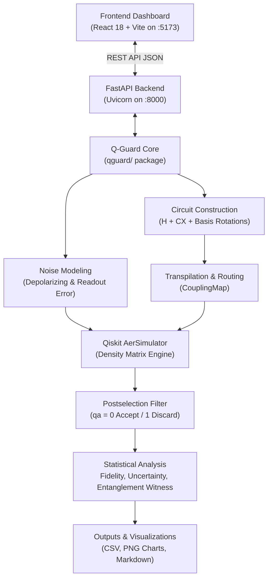

# Q-Guard: Quantum Error Detection and Noise Analysis

**Track:** Hackathon Basic Track  
**Engine:** Qiskit 2.5.2 & Qiskit Aer 0.17.2  
**Full-Stack Architecture:** Python FastAPI + React 18 + Vite + Recharts  
**Target Bell State:** $|\Phi^+\rangle = \frac{|00\rangle + |11\rangle}{\sqrt{2}}$  

---

## 🎥 Project Demo Video
[▶ Watch Q-Guard Demo](https://drive.google.com/file/d/1nTKyGhLLP3z7efpCGr93E5YQrpcxuf-5/view?usp=sharing)
[▶ Watch Q-Guard Demo Presentation](https://drive.google.com/file/d/1tIhPab4vhWfsUdNH_TAJ5sdbmD606jNj/view?usp=sharing)

## 📄 Project Documentation
- [Project Report (PDF)](https://drive.google.com/file/d/1Dklhgt_YoYBr9OvVyjvbSw6XTuOhCns8/view?usp=sharing)


## 1. Project Overview & Scientific Problem

Quantum processors operating in the Noisy Intermediate-Scale Quantum (NISQ) era suffer from physical decoherence, gate imperfections, and measurement readout errors. Preparing high-fidelity entangled Bell states is fundamental for quantum key distribution (QKD), quantum teleportation, and quantum networking.

Full-scale active Quantum Error Correction (QECC) requires dozens of physical qubits per logical qubit. **Q-Guard** evaluates an ancilla-assisted $ZZ$ parity-check postselection strategy:
1. **Error Detection Scope:** Can an extra ancilla qubit measure $ZZ$ parity to filter out bit-flip errors?
2. **The NISQ Gate Noise Trade-off:** Does the physical noise introduced by the extra two-qubit CNOT gates and increased circuit depth outweigh the postselection benefit?
3. **Topology Sensitivity:** How do physical hardware geometries (linear 5Q, planar 7Q, heavy-connectivity 9Q) impact routing depth and fidelity?

Q-Guard provides both an **interactive full-stack web dashboard** and a **command-line scientific experiment pipeline** executing numerical quantum density matrix simulations on Qiskit Aer.

---

## 2. System Architecture



---

## 3. Directory Structure

```
Q-Guard/
├── main.py                      # Master command-line experiment pipeline
├── generate_report.py           # Generates final summary CSV and PNG charts
├── final_report.py              # Aggregates multi-seed experiment statistics
├── test_metrics.py              # Unit tests for quantum fidelity and observables
├── test_qguard.py               # Unit tests for quantum circuits and Aer simulations
├── requirements.txt             # Unified Python dependencies (quantum + backend)
├── package.json                 # Root npm scripts routing to frontend
├── start_servers.bat            # One-click Windows batch launcher
├── start_servers.ps1            # One-click PowerShell launcher
├── README.md                    # Project documentation & execution guide
├── SUBMISSION_NOTES.md          # Submission compliance summary
├── backend/                     # FastAPI REST API Backend
│   ├── app/
│   │   ├── main.py              # FastAPI application & CORS configuration
│   │   ├── schemas.py           # Pydantic request & response schemas
│   │   ├── services/
│   │   │   └── experiment_service.py # Bridges API to Q-Guard engine
│   │   └── routes/
│   │       ├── health.py        # Health & runtime version check
│   │       └── experiments.py   # Run single/batch simulations & query results
│   ├── requirements.txt         # Backend and simulation dependencies
│   └── .env.example             # Backend environment template
├── frontend/                    # React 18 + Vite Web Application
│   ├── src/
│   │   ├── components/
│   │   │   ├── Navbar.jsx       # Header with CSV export & theme toggle
│   │   │   ├── Sidebar.jsx      # Navigation sidebar
│   │   │   ├── MetricCard.jsx   # Top-level metric summary cards
│   │   │   ├── FidelityChart.jsx# Grouped bar chart with 0.50 threshold line
│   │   │   ├── CorrelationChart.jsx # XX, YY, ZZ observable breakdown
│   │   │   ├── ResultsTable.jsx # Sortable experiment data table
│   │   │   ├── ExperimentForm.jsx # Interactive simulation runner form
│   │   │   └── LoadingState.jsx # Quantum simulation spinner
│   │   ├── pages/
│   │   │   ├── Dashboard.jsx    # Real-time metrics & charts overview
│   │   │   ├── Experiments.jsx  # Interactive runner & live inspection
│   │   │   ├── Results.jsx      # Sortable tables, charts & CSV export
│   │   │   ├── Methodology.jsx  # Physics & mathematical walkthrough
│   │   │   └── About.jsx        # Technology stack & scientific disclaimers
│   │   ├── services/
│   │   │   └── api.js           # API communication client
│   │   ├── App.jsx              # Main layout & router
│   │   ├── main.jsx             # React entrypoint
│   │   └── styles.css           # Quantum aesthetic styling
│   ├── package.json             # Frontend dependencies & Vite scripts
│   ├── vite.config.js           # Vite dev server & proxy configuration
│   ├── .env.example             # Frontend environment template
│   ├── .env                     # Local frontend environment
│   └── index.html               # Web application entry HTML
├── config/
│   └── processors.json          # Configurable processor topologies & error rates
├── qguard/                      # Pure Python quantum core
│   ├── circuits.py              # Bell state circuits & basis rotations
│   ├── noise.py                 # Depolarizing & readout error channels
│   ├── simulator.py             # AerSimulator builder
│   ├── metrics.py               # Fidelity, uncertainty & threshold evaluation
│   ├── validation.py            # Graph topology & configuration validator
│   ├── experiments.py           # Experiment pipeline & resource metrics
│   └── reporting.py             # CSV summaries, plots & final markdown report
├── tests/                       # Automated Unit & Backend API Tests
│   ├── test_backend_api.py      # FastAPI endpoint integration tests
│   ├── test_circuits.py         # Quantum circuit layout tests
│   ├── test_experiments.py      # Experiment runner tests
│   ├── test_metrics.py          # Tomography and fidelity tests
│   ├── test_noise.py            # Noise model tests
│   ├── test_reporting.py        # Report generation tests
│   └── test_validation.py       # Topology validator tests
├── scripts/                     # Standalone CLI tools
│   ├── validate_seeds.py        # 10-seed statistical validator
│   ├── analyze_results.py       # Protection trade-off analyzer
│   ├── analyze_geometry.py      # Processor graph topology analyzer
│   ├── verify_noise.py          # Physical noise channel verification
│   ├── verify_protection.py     # Injected fault detection verification
│   └── make_submission_zip.py   # Submission packaging utility
├── docs/                        # Complete technical documentation
│   ├── RUN_WEBSITE.md           # Step-by-step website running guide
│   ├── REQUIREMENTS_AUDIT.md    # Hackathon Basic Track compliance checklist
│   ├── METHODOLOGY.md           # Physics & mathematical equations
│   └── LIMITATIONS.md           # Scientific analysis of NISQ gate noise
└── outputs/                     # Generated results & high-res PNG plots
    ├── experiment_results.csv   # Complete record of all executed experiments
    ├── results.csv              # Current benchmark matrix results
    ├── summary_results.csv      # Statistical summary
    ├── protection_analysis.csv  # Trade-off comparisons
    ├── geometry_analysis.csv    # Graph connectivity metrics
    ├── multi_seed_validation.csv# 10-seed reproducibility data
    ├── final_multi_seed_report.csv
    ├── fidelity_comparison.png  # Fidelity comparison chart
    ├── acceptance_rate.png      # Postselection acceptance rates
    ├── circuit_overhead.png     # Gate count and depth overheads
    ├── processor_comparison.png # Multi-processor comparison
    └── final_report.md          # Comprehensive Markdown summary
```

---

## 4. Prerequisites & Environment Setup

### Prerequisites
- **Python:** 3.10, 3.11, or 3.12 (Python 3.12 recommended)
- **Node.js:** 18.0.0 or higher
- **npm:** 9.0.0 or higher

### Environment Setup

1. **Clone or open the repository root:**
   ```powershell
   cd <path-to-project-root>
   ```

2. **Set up Python Virtual Environment:**
   ```powershell
   # Create virtual environment if not already present
   python -m venv .venv

   # Activate virtual environment
   # Windows PowerShell:
   .\.venv\Scripts\Activate.ps1
   # Windows CMD:
   .\.venv\Scripts\activate.bat

   # Install dependencies
   pip install -r requirements.txt
   ```

3. **Set up Frontend Dependencies:**
   ```powershell
   cd frontend
   npm install
   cd ..
   ```

---

## 5. How to Run the Application

### Option A: One-Click Launchers (Recommended for Windows)

From the project root:
- **Batch script:** Double-click or run:
  ```cmd
  start_servers.bat
  ```
- **PowerShell script:**
  ```powershell
  .\start_servers.ps1
  ```

Both scripts verify the virtual environment, check frontend dependencies, launch the backend and frontend in separate processes, and open your browser to `http://localhost:5173`.

### Option B: Manual Two-Terminal Launch

#### Terminal 1 — Backend (FastAPI):
```powershell
# From project root
.\.venv\Scripts\activate
python -m uvicorn backend.app.main:app --host 127.0.0.1 --port 8000 --reload
```
- **Backend API:** `http://127.0.0.1:8000`
- **Interactive Swagger Docs:** `http://127.0.0.1:8000/docs`
- **Alternative ReDoc:** `http://127.0.0.1:8000/redoc`

#### Terminal 2 — Frontend (React + Vite):
```powershell
# From project root (using root package.json helper)
npm run dev

# Or directly from frontend/
cd frontend
npm run dev
```
- **Frontend Dashboard:** `http://localhost:5173`

---

## 6. How to Run Experiments & Tests

### Automated Test Suites
Run the 50 automated unit and backend API tests:
```powershell
# From project root with venv active
python -m unittest discover -s tests -v

# Run root metric tests
python test_metrics.py

# Run root circuit simulation tests
python test_qguard.py
```

### Full Benchmark Matrix Pipeline
Execute the full 3x3 matrix across all three processor topologies:
```powershell
python main.py
```

### Additional Verification Scripts
```powershell
# Multi-seed validation (10 deterministic seeds per condition)
python scripts/validate_seeds.py

# Fault-injection verification (X vs Z error detection)
python scripts/verify_protection.py

# Physical noise model verification
python scripts/verify_noise.py

# Processor topology and graph connectivity analysis
python scripts/analyze_geometry.py

# Generate final charts and CSV summary
python generate_report.py
```

---

## 7. Key Scientific Findings & Measured Results

| Processor Topology | Experiment Case | Estimated Fidelity $F$ | Uncertainty $\sigma_F$ | $F - 2\sigma_F$ | Threshold $(> 0.5)$ | Acceptance Rate | Depth | 2Q Gates |
| :--- | :--- | :---: | :---: | :---: | :---: | :---: | :---: | :---: |
| **2016-Inspired** (5Q) | Ideal | 1.00000 | 0.00000 | 1.00000 | PASS | 100.0% | 4.0 | 1.0 |
| | Noisy Baseline | 0.92102 | 0.00302 | 0.91498 | PASS | 100.0% | 4.0 | 1.0 |
| | Noisy + Protection | 0.88507 | 0.00377 | 0.87753 | PASS | 91.1% | 9.0 | 6.0 |
| **Contemporary** (7Q) | Ideal | 1.00000 | 0.00000 | 1.00000 | PASS | 100.0% | 4.0 | 1.0 |
| | Noisy Baseline | 0.96277 | 0.00211 | 0.95856 | PASS | 100.0% | 4.0 | 1.0 |
| | Noisy + Protection | 0.94491 | 0.00260 | 0.93970 | PASS | 95.5% | 9.0 | 6.0 |
| **Hyperbolic-Inspired** (9Q) | Ideal | 1.00000 | 0.00000 | 1.00000 | PASS | 100.0% | 4.0 | 1.0 |
| | Noisy Baseline | 0.94409 | 0.00256 | 0.93897 | PASS | 100.0% | 4.0 | 1.0 |
| | Noisy + Protection | 0.92835 | 0.00297 | 0.92241 | PASS | 94.2% | 9.0 | 6.0 |

### Scientific Conclusions:
1. **Entanglement Witness Passed:** Across all processors and noise conditions, $F - 2\sigma_F > 0.50$, proving non-classical bipartite entanglement with >95% confidence.
2. **NISQ Gate Noise Penalty:** Ancilla-assisted postselection adds 5 extra CNOT operations (+5 circuit depth). In realistic NISQ processors with 1%–2.5% two-qubit depolarizing error, the gate errors from syndrome extraction exceed the error-detecting benefit. Thus, protected fidelity is slightly lower than unmitigated baseline.
3. **Selective Detection:** $ZZ$ parity postselection detects 100% of bit-flip ($X$) errors, but is mathematically blind to phase-flip ($Z$) errors ($Z$ commutes with $Z \otimes Z$).
4. **Illustrative Hardware Presets:** Processor topologies and noise rates are illustrative model benchmarks designed to test routing and topology differences, not calibrated official hardware specifications.

---

## 8. Troubleshooting Guide

### 1. `ENOENT: no such file or directory, open '...package.json'`
- **Cause:** Running `npm` from a directory without a `package.json`.
- **Solution:** 
  - Either run `cd frontend` and execute `npm run dev` or `npm install`.
  - Or use the root `package.json` scripts (`npm run dev` / `npm run build`), which automatically delegate to `--prefix frontend`.

### 2. Python Import Errors (`No module named qguard` or `No module named fastapi`)
- **Cause:** Python running outside the virtual environment, or repository root not in `PYTHONPATH`.
- **Solution:**
  - Activate the project virtual environment before running commands:
    ```powershell
    .\.venv\Scripts\Activate.ps1
    ```
  - Verify that packages are installed:
    ```powershell
    pip install -r requirements.txt
    ```

### 3. Occupied Ports (Port 8000 or Port 5173 already in use)
- **FastAPI (8000):** If port 8000 is occupied, find the occupying process and stop it:
  ```powershell
  Get-NetTCPConnection -LocalPort 8000 | Select-Object OwningProcess
  Stop-Process -Id <PID>
  ```
- **Vite (5173):** Vite automatically falls back to 5174 if 5173 is occupied. If you prefer port 5173, terminate the existing node process.

### 4. CORS Errors in Browser
- **Cause:** Frontend attempting to contact backend from an unauthorized origin.
- **Solution:** 
  - Ensure backend `backend/app/main.py` has authorized the origin, or set `CORS_ORIGINS` in your environment:
    ```powershell
    $env:CORS_ORIGINS="http://localhost:5173,http://127.0.0.1:5173,http://localhost:4173,http://127.0.0.1:4173"
    ```
  - Also ensure `frontend/.env` has `VITE_API_BASE_URL=http://127.0.0.1:8000`.

### 5. `PowerShell Execution Policy Error` (`Activate.ps1 cannot be loaded`)
- **Cause:** PowerShell execution policy restricts scripts.
- **Solution:**
  - Run:
    ```powershell
    Set-ExecutionPolicy -Scope Process -ExecutionPolicy Bypass
    ```
  - Or use `.\start_servers.bat` which launches command-prompt runners without policy restrictions.
